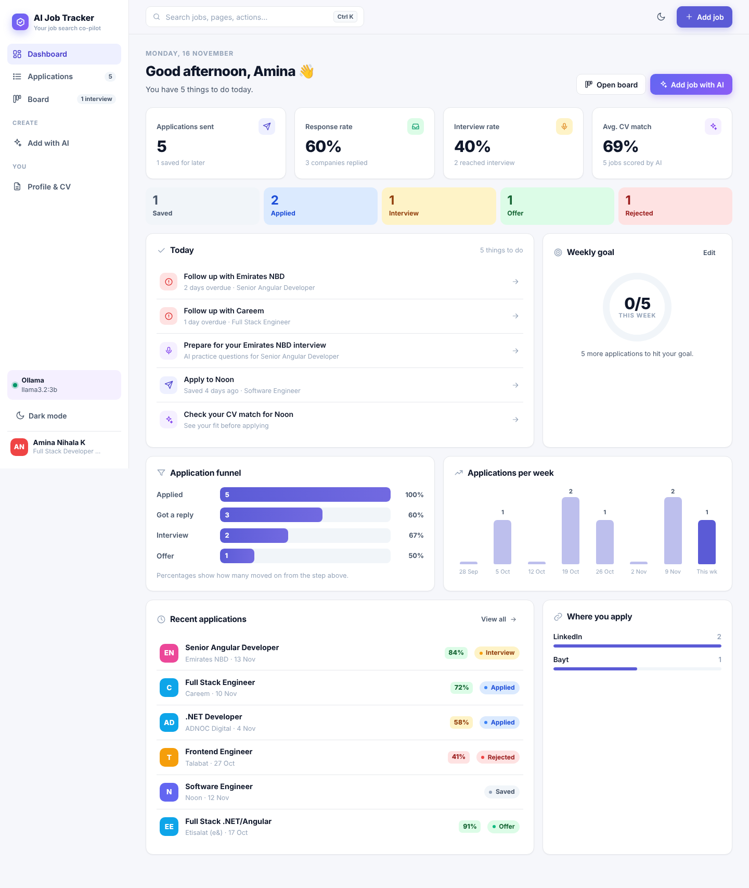

<h1 align="center">Hi, I'm Amina Nihala K 👋</h1>
<h3 align="center">Full Stack Developer · Angular & .NET Core · Dubai, UAE</h3>

  
  
  

---

### 💼 About me

- 🧑‍💻 **4 years** building enterprise web apps with **Angular, .NET Core, C# and SQL Server**
- ⚖️ Built **Legal Operations Automation** modules for a law-firm platform (Angular, .NET Core, EF Core, Kendo UI)
- 📧 Worked on **Neptik**, a B2B email campaign platform, and **cut page load times by 30%** with lazy loading, OnPush change detection and better API design
- 🐳 Currently levelling up in **DevOps**: Docker, CI/CD with GitHub Actions, and Azure
- 🌍 Based in **Dubai** · English & Malayalam

### ⭐ Featured project: [AI Job Tracker](https://github.com/Nihala32/jobtracker-devops)

A full stack job search assistant with built-in AI. Paste a job advert and it fills in the details,
scores how well your CV fits, tailors your CV, writes cover letters, prepares interview questions and drafts follow-up emails.

  
  
  
  
  
  

- Provider-agnostic AI client (local Llama via Ollama, or Groq / Gemini / OpenAI by config)
- Kanban board, analytics dashboard, dark mode, Ctrl+K command palette
- xUnit tests, Docker Compose, CI/CD publishing images to GitHub Container Registry

### 🛠️ Tech stack

**Frontend** 

**Backend & data** 

**DevOps & tools** 

### 🎓 Education & certifications

- **Bachelor of Computer Applications (BCA)**, SAFI Institute of Advanced Study, Kerala
- **Azure: Understanding the Big Picture**

---

<i>Open to Full Stack, Angular and .NET roles in the UAE. Let's connect on <a href="https://www.linkedin.com/in/amina-nihala-670538222">LinkedIn</a>!</i>

