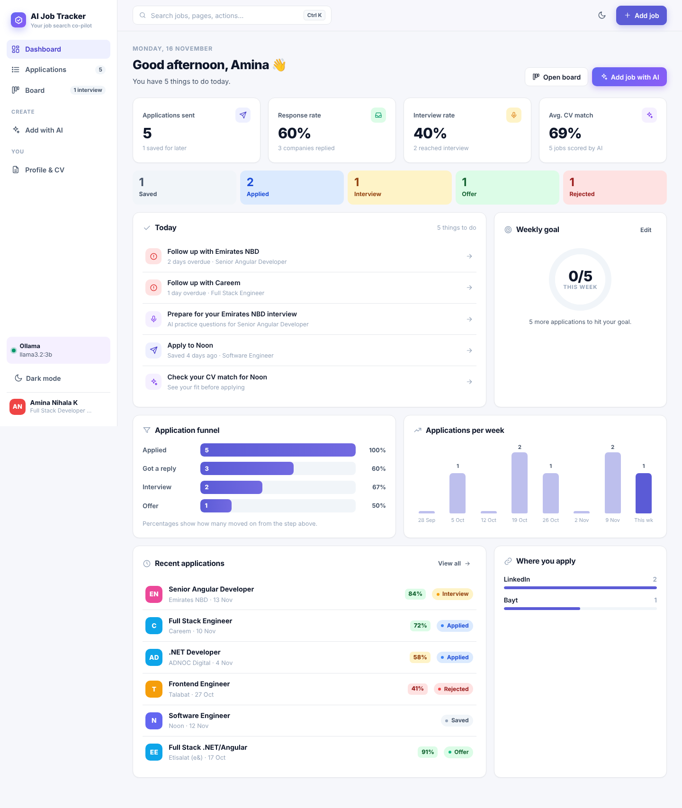
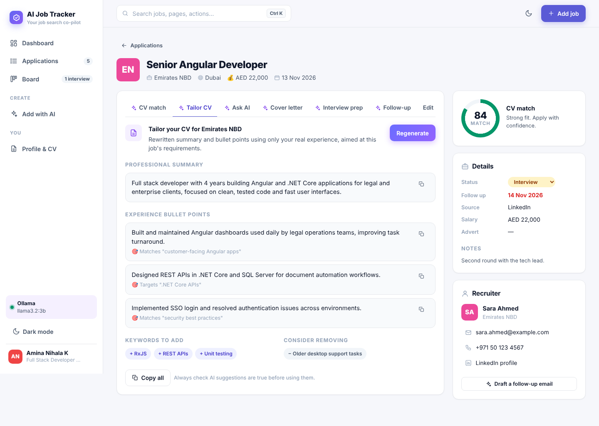
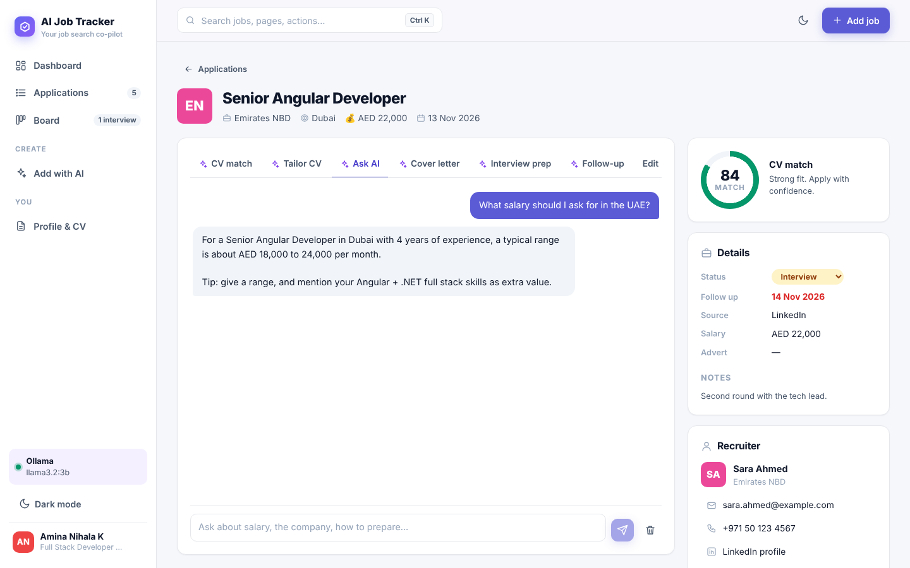
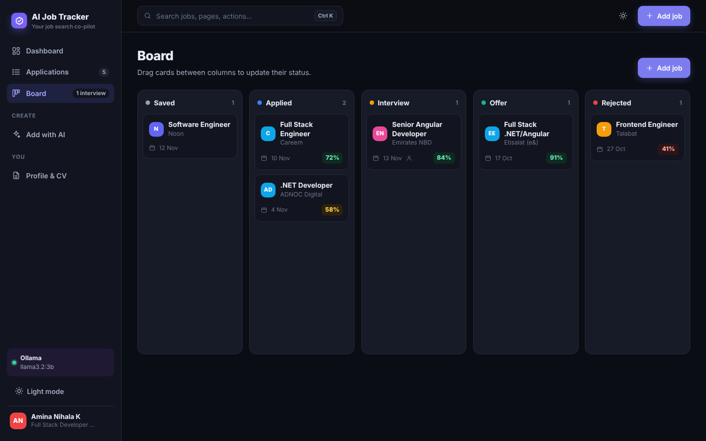
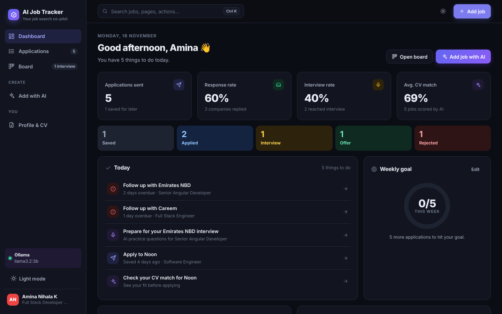
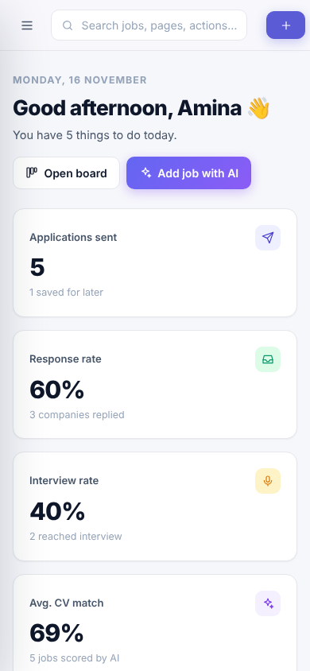

# AI Job Tracker
[](https://github.com/Nihala32/jobtracker-devops/actions/workflows/ci.yml)

A full stack job application tracker with built-in AI. Paste a job advert and the AI fills in the form,
scores how well your CV fits, writes a tailored cover letter, prepares interview questions and drafts follow-up emails.
Runs fully in Docker, with a free local AI model or any OpenAI-compatible provider.



## Features

### AI features
| Feature | What it does |
|---|---|
| **Job analyser** | Paste a job advert; extracts company, role, location, salary, seniority and key skills, and fills the form |
| **CV match score** | Compares your CV with the job: 0–100 score, matched and missing skills, improvement tips |
| **CV tailoring** | Rewrites your summary and bullet points for a specific job, using only your real experience |
| **Ask AI (chat)** | A career-coach chat that knows the job description and your CV: salary, red flags, how to prepare |
| **Cover letter generator** | Tailored letter in three tones, editable before you copy it |
| **Interview prep** | Likely technical and behavioural questions with hints for strong answers |
| **Follow-up emails** | Stage-aware email draft that opens in your email app, addressed to the recruiter |

### Tracking and productivity
- **Today list**: overdue follow-ups, interviews to prepare for, saved jobs to apply to
- **Weekly goal ring**, application **funnel**, weekly chart, response and interview rates, top job sources
- **Recruiter contacts** per job with one-click email, phone and LinkedIn
- **Kanban board** with drag-and-drop status changes (optimistic UI updates)
- Search, status tabs, sorting (including "best match first"); CSV export that opens cleanly in Excel

### User experience
- Modern SaaS layout: sidebar navigation, **light and dark mode**, **Ctrl + K command palette**
- Skeleton loaders, empty states, toast notifications, keyboard support and reduced-motion support
- Responsive design that works on mobile (off-canvas menu)

| Job details + CV tailoring | Ask AI chat | Dark mode board |
|---|---|---|
|  |  |  |

| Dark mode dashboard | Mobile |
|---|---|
|  |  |

## Tech stack
- **Frontend:** Angular 22 (standalone components, signals, zoneless change detection, custom design system with CSS variables), served by nginx
- **Backend:** .NET 8 Web API, Entity Framework Core, SQL Server 2022
- **AI:** provider-agnostic client for the OpenAI-compatible Chat Completions API — **Ollama** (local), Google Gemini, Groq or OpenAI, chosen by configuration only
- **Quality:** 25 xUnit tests for the AI parsing, prompts, chat history, analytics and CSV export (AI is faked in tests, so they are fast and free)
- **DevOps:** Docker Compose with health checks and an optional local-AI profile, GitHub Actions CI (build, test, publish images to GitHub Container Registry)

## Architecture
```
Browser ──► Angular (nginx :4200) ──► .NET 8 API (:8080) ──► SQL Server
                                            │
                                            └──► AI provider (Ollama container, or Gemini / Groq / OpenAI)
```

Design notes:
- `IAiClient` hides the provider, so `JobAiService` (prompts + parsing) is unit-tested with a fake client.
- Models sometimes wrap JSON in markdown or add extra text; `AiJson` extracts and validates it, and scores are clamped.
- AI endpoints are rate-limited (10 requests/minute) and return clear `502` / `400` / `429` errors the UI shows as toasts.
- API keys come from environment variables or a `.env` file, never from source control.
- `/health` reports database health for Docker and monitoring.

## Run it locally
You only need Docker Desktop.

```bash
git clone https://github.com/Nihala32/jobtracker-devops.git
cd jobtracker-devops
cp .env.example .env            # Windows PowerShell: copy .env.example .env

# Option A: everything local, including a free AI model (first run downloads ~2 GB)
docker compose --profile local-ai up -d --build

# Option B: use a cloud AI provider. Edit .env (Gemini or Groq have free tiers), then:
docker compose up -d --build
```

Then open:
- App: http://localhost:4200 (start on the **Profile** page and paste your CV)
- API docs (Swagger): http://localhost:8080/swagger
- Health: http://localhost:8080/health

> Local AI on a laptop CPU can take 20–60 seconds per request. A cloud provider answers in a few seconds.

## Run the tests
```bash
dotnet test JobTracker.Tests
```

## API overview
| Method | Endpoint | Purpose |
|---|---|---|
| GET/POST | `/api/JobApplications` | List / create applications |
| GET/PUT/DELETE | `/api/JobApplications/{id}` | Read / update / delete one |
| PATCH | `/api/JobApplications/{id}/status` | Change status (used by the board) |
| GET | `/api/JobApplications/stats` | Dashboard analytics |
| GET | `/api/JobApplications/export` | CSV download |
| GET/PUT | `/api/profile` | Your CV and details |
| GET | `/api/ai/status` | Which AI provider and model is configured |
| POST | `/api/ai/analyze-job` | Extract details from a job advert |
| POST | `/api/ai/jobs/{id}/match` | CV match score |
| POST | `/api/ai/jobs/{id}/cover-letter?tone=` | Cover letter |
| POST | `/api/ai/jobs/{id}/interview-prep` | Interview questions |
| POST | `/api/ai/jobs/{id}/follow-up-email` | Follow-up email |
| POST | `/api/ai/jobs/{id}/tailor-cv` | Tailored CV summary and bullets |
| POST | `/api/ai/jobs/{id}/chat` | Chat about a job |

## Pre-built images
```bash
docker pull ghcr.io/nihala32/jobtracker-api:latest
docker pull ghcr.io/nihala32/jobtracker-ui:latest
```

## Roadmap
- [x] GitHub Actions CI pipeline with unit tests
- [x] Publish Docker images to GitHub Container Registry
- [x] AI features with a pluggable provider
- [ ] Run on local Kubernetes
- [ ] Infrastructure as code with Terraform
- [ ] Sign-in so several users can keep separate trackers
