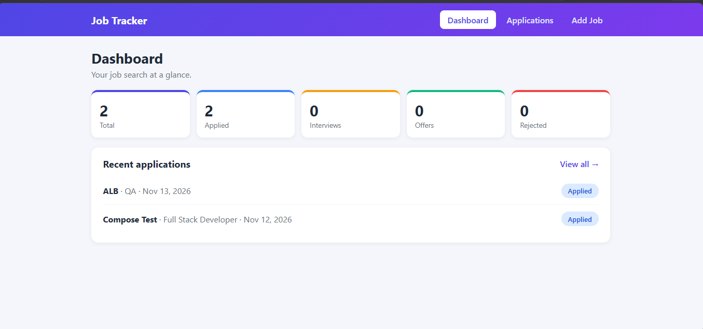

# Job Application Tracker
[](https://github.com/Nihala32/jobtracker-devops/actions/workflows/ci.yml)

A full stack app for tracking job applications, fully containerized with Docker.




## Tech stack
- **Frontend:** Angular (routing, signals, toast notifications), served by nginx
- **Backend:** .NET 8 Web API, Entity Framework Core
- **Database:** SQL Server 2022
- **DevOps:** Docker, Docker Compose with health checks and one-command startup

## Features
- Dashboard with status summary cards
- Add, search, filter, update status, and delete applications
- Migrations applied automatically when the API starts

## Run it locally
You only need Docker Desktop installed.

```bash
git clone https://github.com/Nihala32/jobtracker-devops.git
cd jobtracker-devops
docker compose up -d --build
```

Then open:
- App: http://localhost:4200
- API docs (Swagger): http://localhost:8080/swagger

## Architecture
Browser → Angular (nginx) → .NET API → SQL Server

## Roadmap
- [x] GitHub Actions CI pipeline
- [ ] Deploy to Azure